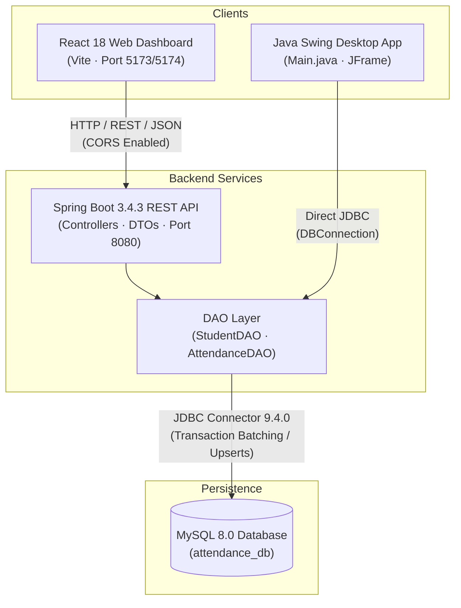

# AttendEase — Student Attendance Management System

AttendEase is a hybrid college administration system designed to streamline student roster management, daily attendance logging, and academic attendance reporting. It pairs a high-performance **Java Spring Boot REST API** and a **MySQL** database with a responsive **React 18 + Vite** administrative web interface, while retaining a native **Java Swing** desktop client.

---

## Architecture Overview

AttendEase employs a dual-client architecture backed by a single MySQL source of truth:



### Design Philosophy
- **Restrained & Editorial**: The web dashboard avoids AI-generated neon gradients and oversized pill shapes, opting for an institutional aesthetic inspired by university software (deep red `#922B24`, burnt orange `#D95D24`, warm off-white `#F7F5F0`, and crisp `#E7E2DA` borders).
- **Dual Client Support**: Administrative staff can manage attendance either through the modern browser interface or via the standalone desktop client.
- **Data Integrity**: Enforces database-level uniqueness on `(student_id, attendance_date)` using MySQL upserts (`ON DUPLICATE KEY UPDATE`) to eliminate duplicate attendance records.

---

## Technology Stack

### Backend & Desktop
- **Language**: Java 21+ (tested on OpenJDK 25 LTS, compiled to release 21 bytecode)
- **Framework**: Spring Boot 3.4.3 (Spring MVC, Jackson)
- **Build System**: Apache Maven 3.9+
- **Database Driver**: MySQL Connector/J 9.4.0
- **Desktop GUI**: Java Swing / AWT

### Frontend Web
- **Core**: React 18.3, Vite 6.4, React Router 6.28
- **Styling**: Tailwind CSS v4 (vanilla CSS variables & design tokens)
- **Visualizations**: Recharts 2.13
- **Icons**: Lucide React

### Database
- **Engine**: MySQL Server 8.0+ (`InnoDB`)
- **Database Name**: `attendance_db`

---

## Project Directory Structure

```
studentattendancesystem/
├── pom.xml                               # Root Maven project configuration
├── .gitignore                            # Root Git ignore rules (secrets, target/, node_modules/)
├── .env.example                          # Backend environment variable template
├── README.md                             # Project documentation
├── src/
│   └── main/
│       ├── java/com/attendance/
│       │   ├── AttendanceApiApplication.java # Spring Boot application entry point
│       │   ├── Main.java                 # Swing desktop application entry point
│       │   ├── Dashboard.java            # Swing desktop JFrame interface
│       │   ├── DBConnection.java         # JDBC connection manager (reads environment variables)
│       │   ├── Student.java              # Student domain model
│       │   ├── StudentDAO.java           # Student database operations
│       │   ├── AttendanceDAO.java        # Attendance persistence & aggregation logic
│       │   ├── config/
│       │   │   └── CorsConfig.java       # CORS configuration for Vite dev origins
│       │   ├── controller/
│       │   │   ├── StudentController.java    # REST controller: /api/students
│       │   │   ├── AttendanceController.java # REST controller: /api/attendance
│       │   │   └── GlobalExceptionHandler.java # Error mapper (HTTP 409, 400, 404, 500)
│       │   └── dto/
│       │       ├── StudentRequest.java       # Student registration payload
│       │       ├── AttendanceItemDto.java    # Student attendance status pair
│       │       ├── SaveAttendanceRequest.java # Batch attendance request
│       │       ├── AttendanceRecordDto.java  # Attendance record response
│       │       ├── StudentSummaryDto.java    # Student metadata DTO
│       │       ├── TrendItemDto.java         # Trend data point DTO
│       │       └── DashboardSummaryDto.java  # Comprehensive dashboard summary DTO
│       └── resources/
│           └── application.properties    # Spring Boot server & database configuration
└── frontend/
    ├── package.json                      # Frontend dependencies & npm scripts
    ├── vite.config.js                    # Vite configuration with Tailwind CSS v4 plugin
    ├── .gitignore                        # Frontend Git ignore
    ├── .env.example                      # Frontend environment variable template
    ├── index.html                        # HTML entry point with favicon and typography
    └── src/
        ├── App.jsx                       # Client router configuration
        ├── index.css                     # Design tokens & color system
        ├── constants.js                  # Departments and semesters configuration
        ├── components/
        │   ├── layout/AppLayout.jsx      # Fixed 230px sidebar & header
        │   └── ui/index.jsx              # StatCard, Button, Badge, Modal, Drawer, etc.
        ├── context/ToastContext.jsx      # Notification toast provider
        ├── hooks/useAsync.js             # Async data loading hook
        ├── pages/
        │   ├── Dashboard.jsx             # Metrics, chronological trend, recent activity
        │   ├── Students.jsx              # Student directory & modal registration
        │   ├── MarkAttendance.jsx        # Batch attendance marking workflow
        │   ├── Reports.jsx               # Analytics, department bar chart, CSV export
        │   └── NotFound.jsx              # 404 fallback page
        ├── services/
        │   ├── apiClient.js              # Fetch client with ApiError handling
        │   ├── studentService.js         # Student API integration
        │   ├── attendanceService.js      # Attendance API integration
        │   └── sampleAdapter.js          # In-memory adapter (when preview mode is enabled)
        ├── data/sampleData.js            # Standalone preview data
        └── utils/format.js               # Date formatting utilities
```

---

## Prerequisites

Before running the system, ensure the following are installed:
- **Java Development Kit (JDK)**: Version 21 or higher (e.g. Eclipse Temurin 21 or 25)
- **Apache Maven**: Version 3.9 or higher
- **Node.js**: Version 18.x or higher and npm
- **MySQL Server**: Version 8.0 or higher

---

## Database Setup

1. Start your local MySQL Server service (`MySQL80` on Windows).
2. Open your MySQL client (CLI or MySQL Workbench) and execute the following DDL script:

```sql
-- 1. Create database
CREATE DATABASE IF NOT EXISTS attendance_db;
USE attendance_db;

-- 2. Create students table
CREATE TABLE IF NOT EXISTS students (
    student_id INT NOT NULL AUTO_INCREMENT,
    roll_no VARCHAR(20) NOT NULL,
    name VARCHAR(100) NOT NULL,
    department VARCHAR(50) DEFAULT NULL,
    semester INT DEFAULT NULL,
    PRIMARY KEY (student_id),
    UNIQUE KEY uk_students_roll_no (roll_no)
) ENGINE=InnoDB DEFAULT CHARSET=utf8mb4 COLLATE=utf8mb4_0900_ai_ci;

-- 3. Create attendance table
CREATE TABLE IF NOT EXISTS attendance (
    attendance_id INT NOT NULL AUTO_INCREMENT,
    student_id INT NOT NULL,
    attendance_date DATE NOT NULL,
    status ENUM('Present', 'Absent') NOT NULL,
    PRIMARY KEY (attendance_id),
    UNIQUE KEY uk_student_attendance_date (student_id, attendance_date),
    CONSTRAINT fk_attendance_students FOREIGN KEY (student_id)
    REFERENCES students (student_id) ON DELETE CASCADE
) ENGINE=InnoDB DEFAULT CHARSET=utf8mb4 COLLATE=utf8mb4_0900_ai_ci;
```

---

## Environment Configuration

### Backend Environment Variables
Set the following environment variables in your terminal or system environment. Do not hardcode passwords in source files.

| Variable | Default Value | Description |
| :--- | :--- | :--- |
| `DB_URL` | `jdbc:mysql://localhost:3306/attendance_db` | JDBC MySQL connection URL |
| `DB_USER` | `root` | Database username |
| `DB_PASSWORD` | *(empty)* | Database user password |
| `PORT` | `8080` | Spring Boot HTTP server port |

### Frontend Environment (`frontend/.env`)
Create `frontend/.env` by copying `frontend/.env.example`:

```bash
cd frontend
cp .env.example .env
```

Ensure the configuration matches:
```env
# URL of the Spring Boot REST API
VITE_API_BASE_URL=http://localhost:8080/api

# Connect to the real backend and MySQL database
VITE_USE_SAMPLE_DATA=false
```

---

## Running the Application

### 1. Start the Spring Boot REST API
Open a terminal in the project root:

**Linux / macOS:**
```bash
export DB_URL="jdbc:mysql://localhost:3306/attendance_db"
export DB_USER="root"
export DB_PASSWORD="your_mysql_password_here"

mvn spring-boot:run
```

**Windows (PowerShell):**
```powershell
$env:DB_URL="jdbc:mysql://localhost:3306/attendance_db"
$env:DB_USER="root"
$env:DB_PASSWORD="your_mysql_password_here"

mvn spring-boot:run
```

The REST API will start on `http://localhost:8080`.

---

### 2. Start the React Frontend
Open a second terminal:

**Windows / Linux / macOS:**
```bash
cd frontend
npm install
npm run dev
```

*(Note: On Windows PowerShell, if running scripts is disabled, use `npm.cmd run dev`).*

The frontend will start at `http://localhost:5173` (or `http://localhost:5174`). Open the URL in your web browser.

---

### 3. Launch the Java Swing Desktop Client (Optional)
Open a third terminal in the project root:

```bash
mvn exec:java
```

This launches the native desktop window (`Dashboard.java`) using the same MySQL database.

---

## REST API Documentation

Base URL: `http://localhost:8080/api`

### 1. Get All Students
- **Method**: `GET`
- **Path**: `/api/students`
- **Response**: `200 OK`
```json
[
  {
    "studentId": 1,
    "rollNo": "CS05001",
    "name": "Aarav Sharma",
    "department": "Computer Science",
    "semester": 5
  }
]
```

### 2. Register New Student
- **Method**: `POST`
- **Path**: `/api/students`
- **Request Body**:
```json
{
  "rollNo": "CS05002",
  "name": "Rohan Mehta",
  "department": "Computer Science",
  "semester": 5
}
```
- **Response**: `201 Created`
- **Errors**: `400 Bad Request` (validation failure), `409 Conflict` (roll number already exists).

### 3. Get Attendance by Date
- **Method**: `GET`
- **Path**: `/api/attendance?date=YYYY-MM-DD`
- **Response**: `200 OK`
```json
[
  {
    "attendanceId": 1,
    "studentId": 1,
    "attendanceDate": "2026-10-21",
    "status": "Present"
  }
]
```

### 4. Save Session Attendance (Batch Upsert)
- **Method**: `POST`
- **Path**: `/api/attendance`
- **Request Body**:
```json
{
  "date": "2026-10-21",
  "records": [
    { "studentId": 1, "status": "Present" },
    { "studentId": 2, "status": "Absent" }
  ]
}
```
- **Response**: `200 OK`
```json
{
  "date": "2026-10-21",
  "saved": 2
}
```
- **Behavior**: Uses MySQL `ON DUPLICATE KEY UPDATE` within a database transaction. If attendance for a student on that date already exists, it updates the status in-place without throwing duplicate key errors.

### 5. Get Attendance Range
- **Method**: `GET`
- **Path**: `/api/attendance/range?from=YYYY-MM-DD&to=YYYY-MM-DD`
- **Response**: `200 OK` (list of attendance records within the date range).

### 6. Get Dashboard Summary
- **Method**: `GET`
- **Path**: `/api/dashboard/summary`
- **Response**: `200 OK`
```json
{
  "totalStudents": 24,
  "referenceDate": "2026-10-21",
  "isToday": true,
  "present": 20,
  "absent": 4,
  "percentage": 83.3,
  "trend": [
    { "date": "2026-10-20", "present": 19, "absent": 5, "percentage": 79 },
    { "date": "2026-10-21", "present": 20, "absent": 4, "percentage": 83 }
  ],
  "recent": [
    {
      "attendanceId": 45,
      "studentId": 1,
      "attendanceDate": "2026-10-21",
      "status": "Present",
      "student": {
        "studentId": 1,
        "name": "Aarav Sharma",
        "rollNo": "CS05001"
      }
    }
  ]
}
```

---

## Build Commands

### Backend Build
Compile classes:
```bash
mvn clean compile
```

Package production JAR:
```bash
mvn clean package
```
Output: `target/studentattendancesystem-1.0.0.jar`

### Frontend Build
Compile production assets:
```bash
cd frontend
npm run build
```
Output: `frontend/dist/`

---

## Docker & Render Deployment

AttendEase includes a production-ready, root-level multi-stage [`Dockerfile`](file:///c:/Users/Anushka/Desktop/studentattendancesystem/Dockerfile) and [`.dockerignore`](file:///c:/Users/Anushka/Desktop/studentattendancesystem/.dockerignore) configured for container platforms such as **Render**.

### Container Architecture
1. **Multi-Stage Build**:
   - **Stage 1 (Builder)**: Uses `maven:3.9.9-eclipse-temurin-21` to compile Java sources and package the self-contained executable Spring Boot fat JAR.
   - **Stage 2 (Runtime)**: Copies the executable JAR into a lightweight `eclipse-temurin:21-jre` container, keeping image size minimal and attack surface low. The React frontend is explicitly excluded via [`.dockerignore`](file:///c:/Users/Anushka/Desktop/studentattendancesystem/.dockerignore).
2. **Dynamic Port Binding**:
   - `application.properties` specifies `server.port=${PORT:8080}`, automatically binding to Render's dynamically injected `$PORT` environment variable (falling back to `8080` locally).
3. **Environment-Driven Database Configuration**:
   - Expects `DB_URL`, `DB_USER`, and `DB_PASSWORD` in the container environment. No credentials are baked into the container.

### Deploying to Render
1. Push this repository to GitHub.
2. On Render, select **New +** → **Web Service**.
3. Connect your repository.
4. Set **Runtime** to **Docker** (Render will automatically detect the root `Dockerfile`).
5. In the **Environment Variables** section, configure:
   - `DB_URL`: e.g. `jdbc:mysql://<mysql-host>:3306/attendance_db`
   - `DB_USER`: e.g. `attendance_user`
   - `DB_PASSWORD`: your hosted database password
   - `JAVA_OPTS` *(optional)*: e.g. `-Xmx512m` for Render free/starter instances
6. Deploy. Render will execute the multi-stage Docker build and start the REST API.

---

## Troubleshooting Guide

### 1. MySQL Authentication Error (`Access denied for user 'root'@'localhost'`)
- **Cause**: The value in `DB_PASSWORD` does not match the MySQL password for the user.
- **Fix**: Verify your MySQL credentials and re-export the environment variable:
  ```powershell
  $env:DB_PASSWORD="your_actual_password"
  ```

### 2. Database Connection Refused (`Communications link failure`)
- **Cause**: The MySQL service is stopped or listening on a different port.
- **Fix**: Check service status on Windows:
  ```powershell
  Get-Service *mysql*
  ```
  If stopped, start it via `Start-Service MySQL80` or through Windows Services.

### 3. CORS Origin Errors in Browser Console
- **Cause**: The frontend origin is not allowed by the backend CORS configuration.
- **Fix**: Backend [`CorsConfig.java`](file:///c:/Users/Anushka/Desktop/studentattendancesystem/src/main/java/com/attendance/config/CorsConfig.java) permits the production Vercel frontend (`https://attendance-system-fuhbffo5y-anushkajoshi1602-5279s-projects.vercel.app`), Vercel preview deployments, and local development origins (`http://localhost:5173`, `http://localhost:5174`, `http://127.0.0.1:5173`, `http://127.0.0.1:5174`). For additional custom domains, pass them via the `ALLOWED_ORIGINS` environment variable (comma-separated).

### 4. Windows PowerShell Script Execution Policy Error
- **Cause**: Windows blocks PowerShell execution of `.ps1` wrapper scripts.
- **Fix**: Use `npm.cmd` instead of `npm`, e.g. `npm.cmd run dev` and `npm.cmd run build`.

---

## Current Limitations & Future Roadmap
- **Authentication**: Currently designed for internal institutional networks; future releases will integrate Spring Security with JWT and role-based access control (Admin, Faculty, Student).
- **Automated Alerts**: Email notifications for students falling below the 75% attendance threshold.
- **Biometric / QR Scanning**: Integration hooks for hardware turnstiles or dynamic QR code attendance checking.
